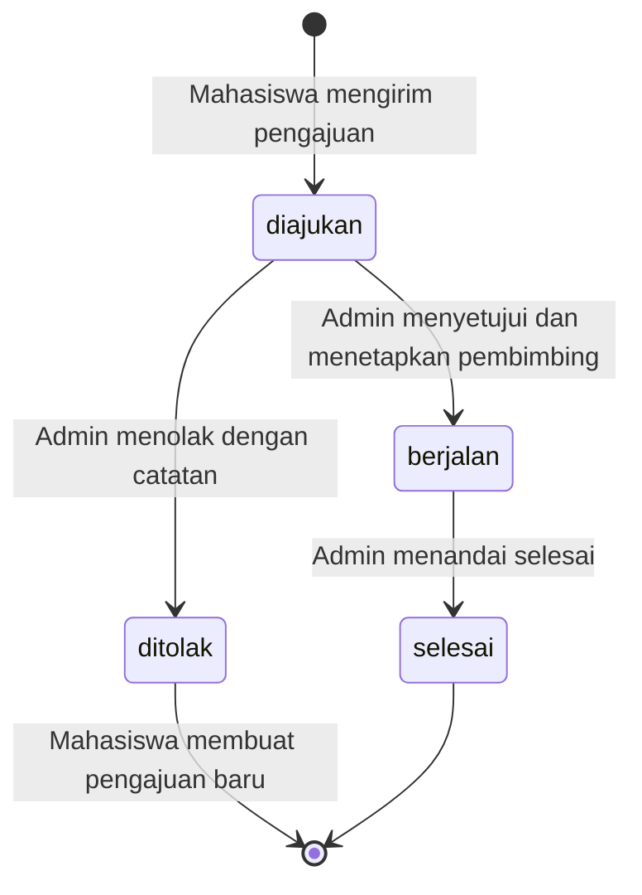
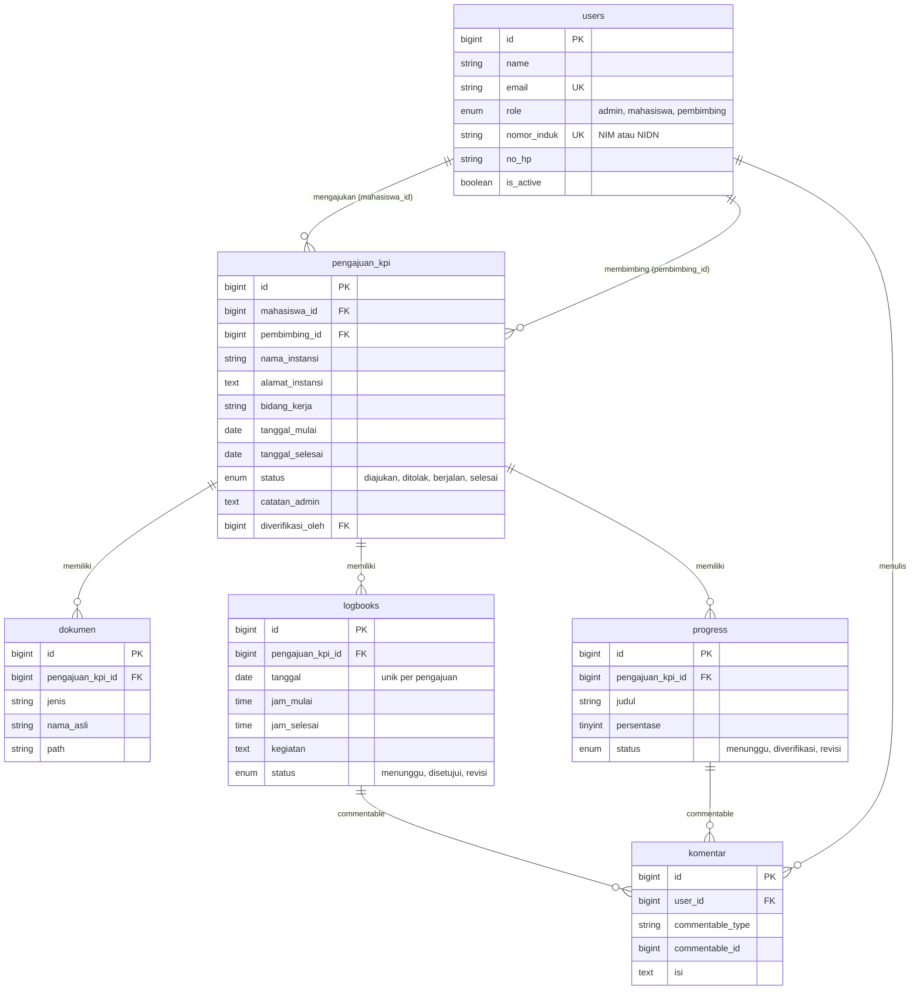

# PrakTI — Platform Praktik Industri Terintegrasi

Sistem informasi berbasis web untuk mengelola Kerja Praktik Industri (KPI) mahasiswa Program Studi Informatika. Dibangun dengan Laravel, MySQL, dan Bootstrap 5 sesuai Project Charter Kelompok 4 (Informatika B).

Folder ini berisi file aplikasi (model, controller, view, migrasi, seeder) yang dipasang di atas proyek Laravel baru.

## 1. Kebutuhan sistem
- Laragon (atau XAMPP) dengan PHP sesuai versi Laravel yang dipakai (Laravel 11 butuh minimal PHP 8.2) dan MySQL
- Composer
- Laravel 11 ke atas (struktur `bootstrap/app.php` versi baru)

## 2. Instalasi

1. Buat proyek Laravel baru dari terminal Laragon:

   ```bash
   cd C:\laragon\www
   composer create-project laravel/laravel prakti
   ```

2. Salin isi folder ini (`app`, `bootstrap`, `database`, `lang`, `public`, `resources`, `routes`) ke folder `prakti`. Pilih **Replace** saat ditanya menimpa file. File yang menimpa bawaan Laravel: `app/Models/User.php`, `app/Providers/AppServiceProvider.php`, `bootstrap/app.php`, `routes/web.php`, dan `database/migrations/0001_01_01_000000_create_users_table.php`, `database/seeders/DatabaseSeeder.php`.

3. Buat database `prakti` (Laragon: klik **Database**, atau lewat HeidiSQL/phpMyAdmin).

4. Ubah file `.env`:

   ```env
   APP_NAME=PrakTI
   APP_URL=http://prakti.test
   APP_LOCALE=id
   APP_FALLBACK_LOCALE=en
   APP_FAKER_LOCALE=id_ID

   DB_CONNECTION=mysql
   DB_HOST=127.0.0.1
   DB_PORT=3306
   DB_DATABASE=prakti
   DB_USERNAME=root
   DB_PASSWORD=

   MAIL_MAILER=log
   MAIL_FROM_ADDRESS="noreply@prakti.test"
   MAIL_FROM_NAME="PrakTI"
   ```

   Laravel 11 ke atas memakai SQLite secara bawaan. Pastikan baris `DB_*` di atas tidak diawali tanda `#`.

5. Atur zona waktu di `config/app.php` menjadi WITA, karena validasi logbook memakai tanggal hari ini:

   ```php
   'timezone' => 'Asia/Makassar',
   ```

6. Jalankan migrasi dan data simulasi:

   ```bash
   php artisan migrate:fresh --seed
   ```

7. Buka `http://prakti.test` (virtual host otomatis Laragon) atau jalankan `php artisan serve` lalu buka `http://127.0.0.1:8000`.

## 3. Akun demo (kata sandi semua akun: `password`)

| Peran | Email | Keadaan data |
| --- | --- | --- |
| Admin | admin@prakti.test | Bisa memverifikasi pengajuan Andi Tenri dan mengaktifkan akun Andi Baso |
| Dosen pembimbing | hasanuddin@prakti.test | Membimbing Nurul (berjalan) dan Fauzan (selesai) |
| Dosen pembimbing | aminah@prakti.test | Membimbing Rizky (logbook terakhir 4 hari lalu) |
| Dosen pembimbing | andibaso@prakti.test | Belum diaktifkan admin, tidak bisa masuk |
| Mahasiswa | nurul@prakti.test | KPI berjalan, ada logbook menunggu dan satu logbook perlu revisi |
| Mahasiswa | rizky@prakti.test | KPI berjalan, ditandai "perlu perhatian" di monitoring |
| Mahasiswa | tenri@prakti.test | Pengajuan menunggu verifikasi |
| Mahasiswa | fitriani@prakti.test | Pengajuan ditolak dengan catatan, bisa ajukan ulang |
| Mahasiswa | fauzan@prakti.test | KPI selesai |
| Mahasiswa | dewi@prakti.test | Belum mengajukan KPI (untuk mencoba alur dari awal) |

## 4. Peta fitur ke file (Tabel 4 Project Charter)

| No | Fitur | Peran | Controller | View |
| --- | --- | --- | --- | --- |
| 1 | Register | Mahasiswa, Dosen | `Auth/AuthController@register` | `auth/register` |
| 2 | Login | Semua | `Auth/AuthController@login` | `auth/login` |
| 3 | Dashboard | Semua | `DashboardController` | `dashboard/admin`, `dashboard/mahasiswa`, `dashboard/pembimbing` |
| 4 | Kelola data pengguna | Admin | `Admin/PenggunaController` | `admin/pengguna/*` |
| 5 | Pengajuan KPI + unggah dokumen | Mahasiswa | `Mahasiswa/PengajuanController` | `mahasiswa/pengajuan/*` |
| 6 | Verifikasi pengajuan KPI | Admin | `Admin/PengajuanController@verifikasi` | `admin/pengajuan/show` |
| 7 | Pengelolaan logbook | Mahasiswa, Pembimbing | `Mahasiswa/LogbookController`, `Pembimbing/BimbinganController` | `mahasiswa/logbook/*`, `shared/logbook` |
| 8 | Monitoring progress KPI | Semua | `Mahasiswa/ProgressController`, `Admin/MonitoringController`, `Pembimbing/BimbinganController` | `mahasiswa/progress/index`, `admin/monitoring/index`, `shared/progress` |
| 9 | Verifikasi & feedback | Pembimbing | `Pembimbing/VerifikasiController`, `KomentarController` | `shared/logbook`, `shared/progress`, `shared/komentar` |

Pendukung: hak akses per peran di `app/Http/Middleware/RoleMiddleware.php`, notifikasi email di `app/Support/Notifikasi.php` dan `app/Notifications/PemberitahuanEmail.php`, unduh dokumen yang dicek hak aksesnya di `DokumenController`.

## 5. Alur status pengajuan



Status logbook: `menunggu` → `disetujui` atau `revisi`. Logbook yang direvisi dan diperbaiki mahasiswa kembali ke `menunggu`. Status progress: `menunggu` → `diverifikasi` atau `revisi`.

## 6. Struktur database (ERD)



## 7. Keputusan desain yang perlu diketahui tim

- **Registrasi dosen menunggu aktivasi.** Charter menyebut register untuk semua user. Agar orang luar tidak bisa mendaftar sebagai dosen lalu melihat data mahasiswa, akun dosen baru berstatus nonaktif sampai admin mengaktifkannya. Akun admin hanya dibuat lewat menu Kelola pengguna atau seeder.
- **Satu pengajuan aktif per mahasiswa.** Mahasiswa tidak bisa mengajukan lagi selama masih ada pengajuan yang menunggu atau berjalan.
- **Satu logbook per hari**, hanya untuk tanggal di dalam periode KPI dan tidak boleh tanggal yang akan datang. Logbook yang sudah disetujui tidak bisa diubah.
- **Berkas disimpan privat** di `storage/app/private` (Laravel 11 ke atas), bukan di folder `public`. Berkas hanya bisa diunduh lewat route yang memeriksa apakah pengguna adalah admin, mahasiswa pemilik, atau dosen pembimbingnya.
- **Email tidak menggagalkan proses.** Jika SMTP belum diatur atau gagal, data tetap tersimpan dan error dicatat di `storage/logs/laravel.log`. Dengan `MAIL_MAILER=log`, isi email bisa dilihat di file log yang sama.
- **Tampilan tanpa build step.** Bootstrap, Bootstrap Icons, dan font dimuat dari CDN, sehingga tidak perlu `npm install`. Untuk server tanpa internet, unduh file tersebut ke `public/` dan ubah tautannya di `resources/views/layouts/*.blade.php`.

## 8. Mengaktifkan email sungguhan (Gmail)

Buat App Password di akun Google (Keamanan > Verifikasi 2 langkah > Sandi aplikasi), lalu ubah `.env`:

```env
MAIL_MAILER=smtp
MAIL_HOST=smtp.gmail.com
MAIL_PORT=587
MAIL_USERNAME=emailkelompok@gmail.com
MAIL_PASSWORD=sandi-aplikasi-16-karakter
MAIL_ENCRYPTION=tls
MAIL_FROM_ADDRESS=emailkelompok@gmail.com
```

Jalankan `php artisan config:clear` setelah mengubah `.env`.

## 9. Skenario uji cepat untuk Tester/QA

1. Daftar akun mahasiswa baru, pastikan langsung masuk ke dashboard dengan ajakan "Ajukan KPI".
2. Daftar akun dosen baru, pastikan tidak bisa masuk sebelum diaktifkan admin, lalu aktifkan dari akun admin.
3. Masuk sebagai `dewi@prakti.test`, kirim pengajuan dengan surat permohonan PDF. Coba kirim berkas selain PDF dan berkas di atas 5 MB, pastikan ditolak dengan pesan yang jelas.
4. Masuk sebagai admin, tolak pengajuan tanpa catatan (harus gagal), lalu tolak dengan catatan. Masuk lagi sebagai Dewi dan pastikan catatan tampil serta form ajukan ulang terisi otomatis.
5. Setujui pengajuan dengan memilih dosen pembimbing. Pastikan pengajuan pindah ke status "Sedang berjalan".
6. Sebagai mahasiswa, isi logbook hari ini. Coba isi tanggal besok atau tanggal yang sama dua kali, pastikan ditolak.
7. Sebagai dosen, minta revisi tanpa catatan (harus dicegah), lalu dengan catatan. Sebagai mahasiswa, perbaiki logbook dan pastikan statusnya kembali "Menunggu diperiksa".
8. Uji hak akses: saat masuk sebagai mahasiswa, buka `/admin/pengguna` dan `/pembimbing/bimbingan`, pastikan muncul 403. Saat masuk sebagai dosen lain, buka `/pembimbing/bimbingan/{id}` milik dosen lain, pastikan 403.
9. Salin tautan unduh dokumen milik Nurul, lalu buka saat masuk sebagai Rizky. Pastikan 403.
10. Nonaktifkan akun mahasiswa yang sedang masuk di browser lain, pastikan langsung dikeluarkan saat membuka halaman berikutnya.

Catatan: `tests/Feature/ExampleTest.php` bawaan Laravel mengharapkan halaman `/` mengembalikan status 200. Di PrakTI halaman `/` mengalihkan ke dashboard atau login (302), jadi sesuaikan atau hapus tes tersebut.
